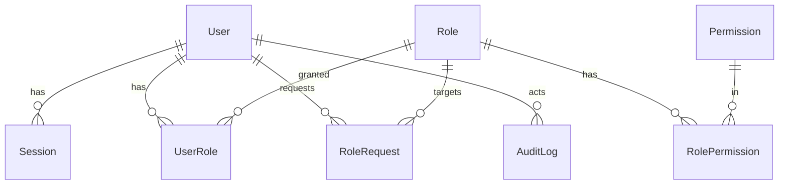
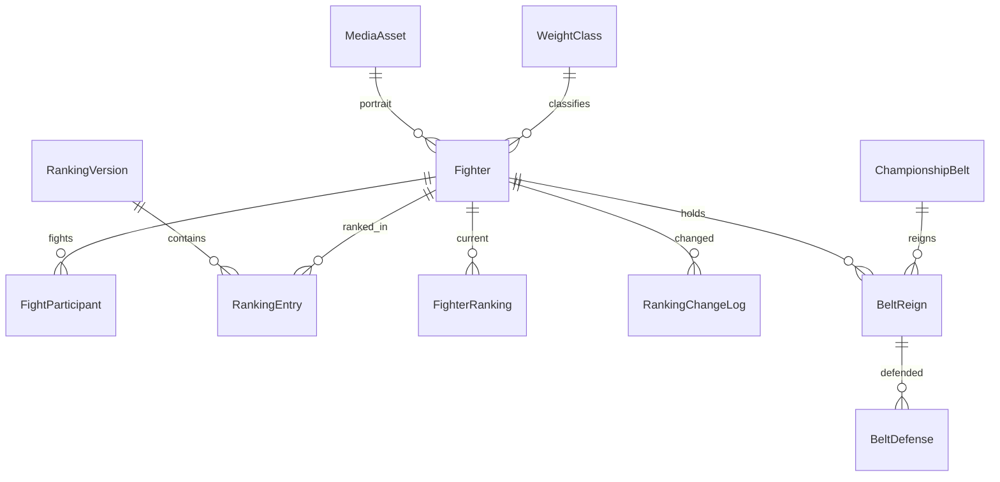
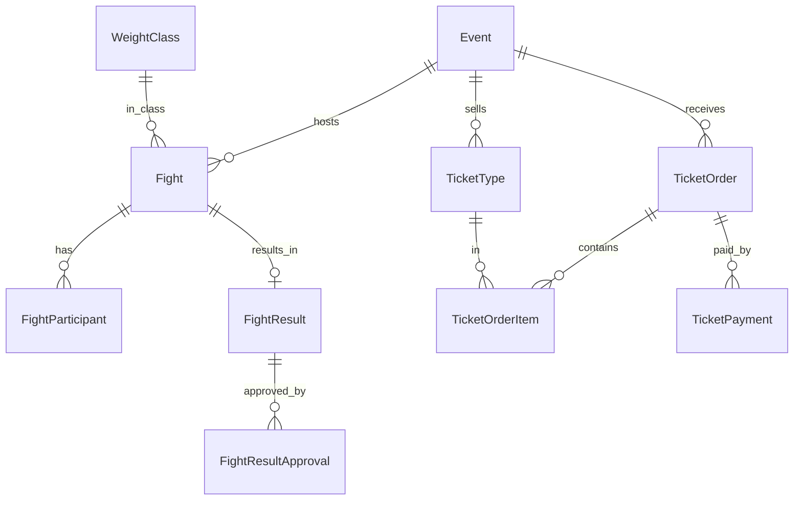
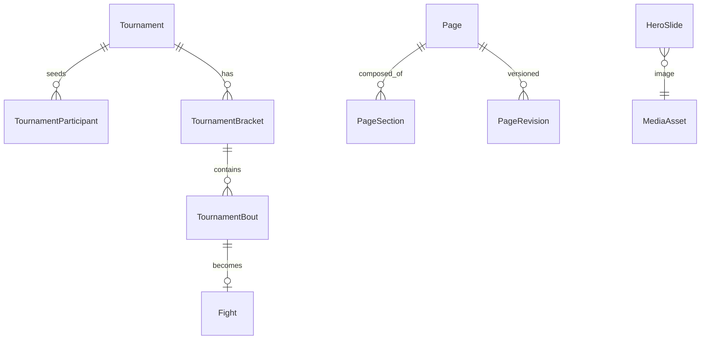
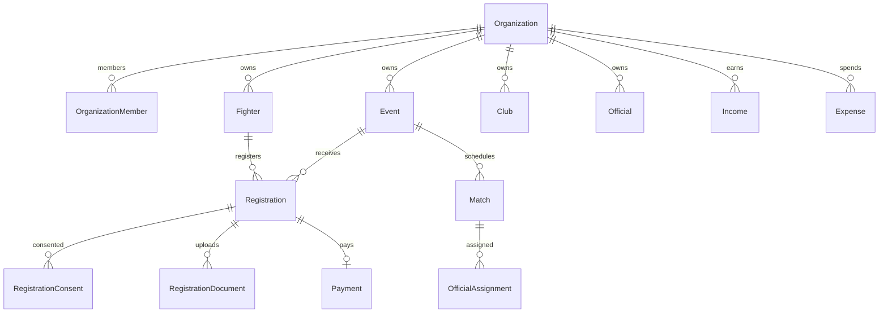

# ERD (Entity Relationship Diagram)

> Mermaid. **Bagian 1 = schema nyata.** Diagram ini disederhanakan: relasi yang tidak penting untuk
> pemahaman alur dihilangkan, kolom hanya yang kunci.

## 1. Auth & RBAC

## 2. Fighter, ranking, belt

## 3. Event, fight, ticketing

Relasi penting:

- `FightParticipant` unik pada `(fightId, corner)` **dan** `(fightId, fighterId)` → satu fighter tidak
  bisa dua kali dalam satu partai.
- `FightResult` unik pada `fightId` → satu hasil per partai.
- `TicketOrderItem` menyimpan `ticketTypeId` + `quantity` + `unitPrice` (snapshot harga).

## 4. Turnamen & CMS

## 5. Target tenant overlay (belum ada)

> Catatan: diagram target ini **rencana**, bukan implementasi. Jangan dipakai sebagai klaim status.
