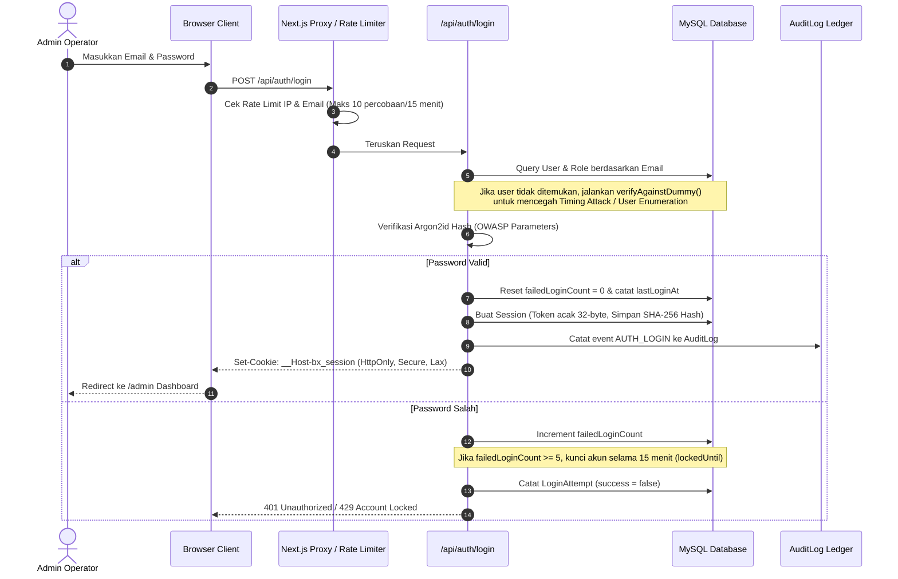

# Panduan & Arsitektur Login Panel Admin (WBC-X)

> **Status:** v1.0 — Production Ready  
> **Source of Truth:** [prd.md](../prd.md) & [docs/RBAC.md](./RBAC.md)  
> **Akses Endpoint:** `/admin/login`  

---

## 1. Cara Mengakses Login Panel

1. **URL Akses:** Buka browser dan arahkan ke:  
   `http://localhost:3000/admin/login`  
   *(Atau klik link **"🔐 ADMIN DASHBOARD LOGIN"** di footer public landing page).*
2. **Dashboard URL:** Setelah login berhasil, Anda akan langsung dialihkan ke:  
   `http://localhost:3000/admin`

---

## 2. Akun & Kredensial Demo (Siap Pakai)

Semua akun demo di-seed otomatis dengan password yang seragam:  
👉 **Password:** `Demo-Ringside-2026!`

Di halaman `/admin/login`, tersedia tombol **"⚡ ONE-CLICK DEMO ACCOUNTS"** di bagian bawah form login. Klik tombol nama role yang diinginkan untuk otomatis mengisi email & password tanpa perlu mengetik manual.

### Matriks Akun Demo Berdasarkan Role:

| Email | Nama Role | Hak Akses Utama |
|---|---|---|
| `superadmin@boxing.local` | **Super Admin** | Akses penuh: kelola semua modul, user, konfigurasi role, approval akhir, dan audit logs. |
| `admin@boxing.local` | **Administrator** | Operasional harian: kelola roster petinju, jadwal event, sabuk juara, dan konten landing page. |
| `rankings@boxing.local` | **Ranking Manager** | Menyusun draft ranking resmi baru per divisi/P4P, mengatur peringkat, dan mengajukan approval (tidak bisa publish langsung). |
| `tournaments@boxing.local` | **Tournament Manager** | Mengelola turnamen Grand Prix, bagan/braket eliminasi, dan seeding peserta. |
| `editor@boxing.local` | **Lead Content Editor** | Mengedit hero slider, media, dan tata letak landing page dalam mode draft. |
| `data@boxing.local` | **Fight Data Manager** | Mencatat ronde, metode kemenangan (KO/TKO/UD), dan detail pertandingan sebagai draft. |
| `reviewer@boxing.local` | **Sanctioning Reviewer** | Memverifikasi hasil pertandingan resmi dan mengesahkan publikasi ranking (Kebijakan Four-Eyes berlaku). |
| `viewer@boxing.local` | **Broadcast Guest** | Hak akses read-only untuk melihat data dan dashboard tanpa izin mengubah data. |

---

## 3. Alur Kerja Keamanan (Security & Session Architecture)

Sistem login ini **bukan mockup atau simulasi statis**, melainkan sistem autentikasi production-ready yang terhubung langsung ke database MySQL:

### Fitur Keamanan yang Diterapkan:
1. **Argon2id Password Hashing:** Algoritma pemenang Password Hashing Competition yang tahan terhadap serangan GPU/ASIC.
2. **Database-Backed Session Tokens:**
   - Token acak 32-byte disimpan di browser menggunakan cookie `HttpOnly`, `Secure` (saat production), dan `SameSite=Lax`.
   - Di database MySQL, token disimpan dalam bentuk **SHA-256 Hash**. Jika database diakses pihak luar, hash tidak dapat digunakan untuk memalsukan cookie session.
3. **Pencegahan Brute-Force & Akun Terkunci:**
   - Rate limit per IP dan per email.
   - Proteksi penguncian akun otomatis selama 15 menit jika 5 kali berturut-turut memasukkan password yang salah.
4. **Timing Attack Equalizer:** Server mengeksekusi perhitungan hash tiruan saat email tidak ditemukan, sehingga durasi respon selalu konsisten dan hacker tidak bisa menebak apakah suatu email terdaftar atau tidak.
5. **Kebijakan Pemisahan Tugas (Four-Eyes Policy):** Pengguna yang membuat draft hasil pertandingan atau draft ranking tidak diizinkan untuk meng-approve atau mempublikasikan buatannya sendiri.
6. **Pencabutan Session Instan (Logout):** Tombol **SIGN OUT** di sidebar admin langsung memanggil `/api/auth/logout` yang menandai status session `revokedAt` di MySQL dan menghapus cookie di browser.

---

## 4. Tampilan & Menu Dashboard Admin (`/admin`)

Setelah berhasil login, operator disajikan antarmuka **Cinematic Brutalism** dengan sidebar navigasi lengkap:

1. **Overview (`/admin`):**
   - Kartu metrik live: Total Fighters, Published Rankings, Upcoming Events, Active Grand Prix, Championship Belts.
   - Tabel audit log aktivitas terbaru secara real-time.
2. **Fighters (`/admin/fighters`):**
   - Direktori atlet dengan pencarian nama/alias, filter divisi bobot, metrik fisik (tinggi, jangkauan, kuda-kuda), rekor resmi W-L-D, dan rasio KO.
3. **Rankings (`/admin/rankings`):**
   - Pengelolaan versi ranking per divisi (Draft, Pending Approval, Published).
   - Pengaturan petinju juara dunia (C) dan pergerakan peringkat (+1, -1, dsb.).
4. **Grand Prix (`/admin/grand-prix`):**
   - Manajemen turnamen sistem gugur (single/double elimination).
   - Penentuan bagan pertandingan semi-final dan final.
5. **Championship Belts (`/admin/belts`):**
   - Histori garis suksesi pemegang sabuk dunia (lineage).
   - Pengajuan perpindahan gelar juara dengan database constraint yang menjamin hanya ada 1 pemegang aktif per sabuk.
6. **Audit Logs (`/admin/audit-logs`):**
   - Perekaman seluruh tindakan administratif dengan timestamp, nama aktor, jenis entitas, ringkasan, dan IP address.

