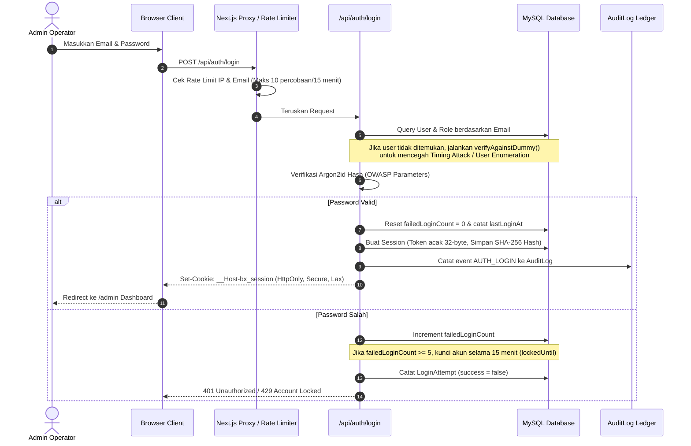

# Panduan & Arsitektur Login Panel Admin (WBC-X)

> **Status:** v1.1 — Production Ready (kredensial demo dipindah ke env, audit 13 Nov 2026)  
> **Source of Truth:** [prd.md](../prd.md) & [docs/RBAC.md](./RBAC.md)  
> **Akses Endpoint:** `/admin/login`  

---

## 1. Cara Mengakses Login Panel

1. **URL Akses:** `{APP_URL}/admin/login`  
   - Development: `http://localhost:3015/admin/login` (nilai `APP_URL` di `.env`)  
   - Production: `https://<domain-produksi>/admin/login`
2. **Tidak ada link login admin di footer** public site — ini disengaja agar panel tidak diiklankan. Buka URL langsung dari browser.
3. **Dashboard URL:** setelah login berhasil, operator dialihkan ke `{APP_URL}/admin`.

---

## 2. Akun & Kredensial Demo (Siap Pakai)

Password akun demo **seragam** dan **tidak ditulis di dokumentasi ini** — nilainya diambil dari environment variable:

👉 **Password:** nilai `DEMO_USER_PASSWORD` di `.env` (baris 15 pada environment dev saat ini)

Kenapa tidak ditulis literal di sini:

- Password demo dirotasi per environment (dev / staging / demo laptop), jadi angka di dokumen akan cepat basi.
- Dokumentasi ikut ter-commit; kredensial literal di repo = kredensial di semua clone.

Cara membaca nilainya:

```bash
grep DEMO_USER_PASSWORD .env
```

**Kapan akun demo ini ada:** seed hanya dijalankan bila `SEED_DEMO_USERS=true` **dan** `NODE_ENV` bukan `production`. `scripts/account-policy.ts` melempar error bila dipaksa di production, jadi akun demo tidak akan pernah ter-seed di server live. Untuk production, buat super admin lewat prosedur bootstrap terpisah, bukan lewat seed demo.

**Form login diketik manual.** Tidak ada tombol *"⚡ ONE-CLICK DEMO ACCOUNTS"* di halaman login — fitur itu ada di draft desain awal dan **tidak pernah diimplementasikan**. Isi email + password sendiri di `/admin/login`.

### Matriks Akun Demo Berdasarkan Role:

| Email | Nama Role | Hak Akses Utama |
|---|---|---|
| `superadmin@boxing.local` | **Super Admin** | Akses penuh: kelola semua modul, user, konfigurasi role, approval akhir, dan audit logs. |
| `admin@boxing.local` | **Administrator** | Operasional harian: kelola roster petinju, jadwal event, sabuk juara, dan konten landing page. |
| `rankings@boxing.local` | **Ranking Manager** | Menyusun draft ranking resmi baru per divisi/P4P, mengatur peringkat, dan mengajukan approval (tidak bisa publish langsung). |
| `tournaments@boxing.local` | **Tournament Manager** | Mengelola turnamen Grand Prix, bagan/braket eliminasi, dan seeding peserta. |
| `editor@boxing.local` | **Lead Content Editor** | Mengedit hero slider, media, dan tata letak landing page dalam mode draft. |
| `data@boxing.local` | **Fight Data Manager** | Mencatat ronde, metode kemenangan (KO/TKO/UD), dan detail pertandingan sebagai draft. |
| `reviewer@boxing.local` | **Sanctioning Reviewer** | Memverifikasi hasil pertandingan resmi dan mengesahkan publikasi ranking (Kebijakan Four-Eyes berlaku). |
| `viewer@boxing.local` | **Broadcast Guest** | Hak akses read-only untuk melihat data dan dashboard tanpa izin mengubah data. |

> **Catatan hasil audit (13 Nov 2026):** delapan akun di atas terverifikasi ada di database `tfn_local`, semuanya `isActive = 1`, `mfaEnabled = 0`, `failedLoginCount = 0`, `lockedUntil = NULL`. Ada satu akun tambahan `e2e-ticketing@tfn.local` (super_admin) yang dibuat oleh test suite E2E — **jangan dipakai untuk login manual** dan jangan dipromosikan ke staging/production.

### Verifikasi kredensial tanpa membuka browser

```bash
set -a && . ./.env && set +a
curl -s -o /tmp/login.json -w "HTTP %{http_code}\n" \
  -X POST "http://localhost:3015/api/auth/login" \
  -H 'Content-Type: application/json' \
  -d '{"email":"superadmin@boxing.local","password":"'"$DEMO_USER_PASSWORD"'"}'
```

`HTTP 200` + body berisi `"roles":["super_admin"]` = kredensial valid. `401` = password salah, `429` = kena rate limit (10/15 menit per IP+email) atau akun terkunci 15 menit setelah 5 kegagalan.

---

## 3. Alur Kerja Keamanan (Security & Session Architecture)

Sistem login ini **bukan mockup atau simulasi statis**, melainkan sistem autentikasi production-ready yang terhubung langsung ke database MySQL:



### Fitur Keamanan yang Diterapkan:
1. **Argon2id Password Hashing:** Algoritma pemenang Password Hashing Competition yang tahan terhadap serangan GPU/ASIC.
2. **Database-Backed Session Tokens:**
   - Token acak 32-byte disimpan di browser menggunakan cookie `HttpOnly`, `Secure` (saat production), dan `SameSite=Lax`.
   - Di database MySQL, token disimpan dalam bentuk **SHA-256 Hash**. Jika database diakses pihak luar, hash tidak dapat digunakan untuk memalsukan cookie session.
3. **Pencegahan Brute-Force & Akun Terkunci:**
   - Rate limit per IP dan per email.
   - Proteksi penguncian akun otomatis selama 15 menit jika 5 kali berturut-turut memasukkan password yang salah.
4. **Timing Attack Equalizer:** Server mengeksekusi perhitungan hash tiruan saat email tidak ditemukan, sehingga durasi respon selalu konsisten dan hacker tidak bisa menebak apakah suatu email terdaftar atau tidak.
5. **Kebijakan Pemisahan Tugas (Four-Eyes Policy):** Pengguna yang membuat draft hasil pertandingan atau draft ranking tidak diizinkan untuk meng-approve atau mempublikasikan buatannya sendiri.
6. **Pencabutan Session Instan (Logout):** Tombol **SIGN OUT** di sidebar admin langsung memanggil `/api/auth/logout` yang menandai status session `revokedAt` di MySQL dan menghapus cookie di browser.

---

## 4. Tampilan & Menu Dashboard Admin (`/admin`)

Setelah berhasil login, operator disajikan antarmuka **Cinematic Brutalism** dengan sidebar navigasi lengkap:

1. **Overview (`/admin`):**
   - Kartu metrik live: Total Fighters, Published Rankings, Upcoming Events, Active Grand Prix, Championship Belts.
   - Tabel audit log aktivitas terbaru secara real-time.
2. **Fighters (`/admin/fighters`):**
   - Direktori atlet dengan pencarian nama/alias, filter divisi bobot, metrik fisik (tinggi, jangkauan, kuda-kuda), rekor resmi W-L-D, dan rasio KO.
3. **Rankings (`/admin/rankings`):**
   - Pengelolaan versi ranking per divisi (Draft, Pending Approval, Published).
   - Pengaturan petinju juara dunia (C) dan pergerakan peringkat (+1, -1, dsb.).
4. **Grand Prix (`/admin/grand-prix`):**
   - Manajemen turnamen sistem gugur (single/double elimination).
   - Penentuan bagan pertandingan semi-final dan final.
5. **Championship Belts (`/admin/belts`):**
   - Histori garis suksesi pemegang sabuk dunia (lineage).
   - Pengajuan perpindahan gelar juara dengan database constraint yang menjamin hanya ada 1 pemegang aktif per sabuk.
6. **Audit Logs (`/admin/audit-logs`):**
   - Perekaman seluruh tindakan administratif dengan timestamp, nama aktor, jenis entitas, ringkasan, dan IP address.

