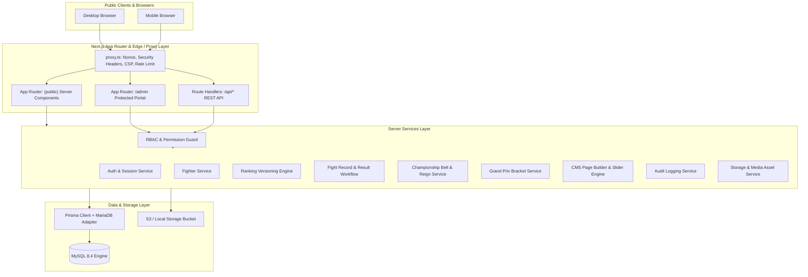

# Architecture Plan — Boxing Championship Platform

> **Status:** v1.0 — Approved  
> **Source of Truth:** [prd.md](../prd.md)  
> **Target Environment:** Node.js 20+, Next.js App Router, MySQL 8 via Prisma ORM  

---

## 1. System Overview

The Boxing Championship Platform is an enterprise-grade full-stack platform providing:
- **Public Website:** Cinematic Brutalism design, high-performance SEO-friendly SSR, interactive 3D Championship Belt, interactive Hero Slider, Fighter Profiles, Grand Prix Tournament Brackets, Weight Class & Pound-for-Pound Rankings, Verified Fight History.
- **Admin Dashboard:** Dedicated operational portal (`/admin`) for fighters, rankings, fights, belts, tournaments, hero slides, page builder, media, users, roles, audit logs, and settings.
- **Security & RBAC Engine:** Granular permission-based access control, session-based authentication in HttpOnly/Secure cookies, Argon2id password hashing, AES-256-GCM encrypted TOTP MFA, strict CSRF mitigation, brute-force mitigation, tamper-evident audit logging, and four-eyes approval workflows for sensitive sports governance actions.

---

## 2. High-Level Architecture Diagram



---

## 3. Technology Choices & Justification

| Layer | Technology | Justification |
|---|---|---|
| **Framework** | Next.js App Router (v16) | Native React Server Components for ultra-fast TTFB and SEO, combined with client components for interactive 3D / motion |
| **Language** | TypeScript (Strict Mode) | Full type-safety across database models, domain DTOs, API responses, and client forms |
| **Database** | MySQL 8.4 via Prisma ORM | ACID-compliant relational storage required for championship lineage, bracket trees, versioned rankings, and audit ledgers |
| **Database Adapter** | `@prisma/adapter-mariadb` | High-performance native JavaScript driver adapter for MySQL 8, avoiding native binary compilation drift |
| **Authentication** | Custom Database-backed Session | HttpOnly, Secure, SameSite=Lax cookie with SHA-256 token hashing; enables instant session revocation, device tracking, and TOTP MFA step-up |
| **Password Hashing** | `@node-rs/argon2` (Argon2id) | OWASP-recommended standard resistant to GPU/ASIC brute-force cracking |
| **Styling & Theme** | Tailwind CSS v4 | Ultra-lean CSS output, custom design tokens matching the Brutalist Cinematic palette (#0A0A0A, #D4A017, #B3121F) |
| **3D Rendering** | Three.js + React Three Fiber + Drei | Procedural 3D Championship Belt with metallic shader, lighting spotlight, and automatic fallback for reduced-motion / non-WebGL devices |
| **UI Motion** | Motion (`motion/react`) | Cinematic entrance animations respecting `prefers-reduced-motion` |

---

## 4. Key Architectural Patterns

1. **Clean Feature-Based Modular Architecture:**
   - Features (`fighters`, `rankings`, `fights`, `tournaments`, `belts`, `cms`, `auth`, `users`, `audit`) are encapsulated in `src/features/*` containing their own schemas, components, and server actions/handlers.
   - Core domain logic lives in `src/server/services/*` with explicit database transactions for state transitions.

2. **Immutable Versioning & Audit Ledgers:**
   - **Rankings:** Draft versions are modified in staging, then published as an immutable snapshot. The public site only queries the currently active version.
   - **Page Builder:** Sections are edited in a draft state and published as an immutable `PageRevision` snapshot, allowing instant rollback.
   - **Belt Reigns:** Each belt has at most ONE active reign enforced by a unique partial index key. Historical reigns remain immutable.
   - **Fight Results:** Require formal submission, verification, and approval before affecting a fighter's official record.

3. **Defense in Depth Security:**
   - Server-side authorization checks on every Route Handler and Server Action. UI hiding is purely for user experience.
   - Cryptographic protection: Session tokens are stored as SHA-256 hashes in MySQL, plain tokens live only in client cookies.
   - Zero Plaintext Secrets: TOTP seeds encrypted with AES-256-GCM.
   - Redaction pipeline strips passwords, tokens, and authorization headers from all logs and audit events.


---

## 5. Ticketing Module (guest order → manual admin verification)

Ticketing is deliberately **NOT** an online payment gateway integration. The organizer collects
payment out-of-band (transfer / QRIS / cash) and an authorized admin confirms it. This keeps the
platform free of third-party payment dependencies while still enforcing quota integrity.

### 5.1 Reservation model

`TicketType.sold` is the **single source of truth for reserved capacity** — it includes confirmed
orders *and* pending holds. Guarded reservation, not read-then-write:

```ts
const reserved = await tx.ticketType.updateMany({
  where: { id, isActive: true, sold: { lte: type.quota - quantity } },
  data: { sold: { increment: quantity } },
});
if (reserved.count !== 1) throw new TicketingError("Kuota tiket tidak mencukupi", "SOLD_OUT");
```

The `UPDATE ... WHERE sold <= quota - qty` runs inside `db.$transaction`, so two concurrent buyers
competing for the last seats cannot both win (verified: 50 parallel requests → exactly 50 seats
allocated, never 51).

### 5.2 Lifecycle

| Transition | Trigger | Sold | Payment |
|---|---|---|---|
| `PENDING_CONFIRMATION` | buyer submits `POST /api/ticketing/orders` | `+qty` (held) | `PROOF_SUBMITTED` when a reference is sent, else `UNPAID` |
| `CONFIRMED` | admin `confirmOrder` (`ticketing.confirm` permission) | unchanged | `VERIFIED` + `verifiedById`/`verifiedAt` + audit log |
| `REJECTED` | admin `rejectOrder` with a required reason | `−qty` (released) | `REJECTED` + audit log |
| `CANCELLED` | reserved for future refund/expiry automation | `−qty` | `REJECTED`/`CANCELLED` |

Rejection must restore capacity atomically; a rejection that forgets `sold` is a silent oversell bug.

### 5.3 Buyer capability token

Guests have no account, so the order is protected by an opaque **capability token**:

- 32-byte random token, returned **once** in the `POST` response.
- Stored as `guestTokenHash = sha256(token)` — plaintext never persists.
- `GET /api/ticketing/orders/[orderNumber]?token=…` looks up by `(orderNumber, guestTokenHash)`.
- A wrong token and a non-existent order are indistinguishable (both 404), so order numbers cannot be enumerated.

### 5.4 Surface area

| Layer | Path | Notes |
|---|---|---|
| Service | `src/server/services/ticketing.service.ts` | `createGuestOrder`, `getGuestOrder`, `confirmOrder`, `rejectOrder`, `listPublishedTicketEvents` |
| Public API | `src/app/api/ticketing/orders/route.ts` | origin (CSRF) + rate limit + Zod → friendly Indonesian messages |
| Lookup API | `src/app/api/ticketing/orders/[orderNumber]/route.ts` | token-gated read |
| Admin actions | `src/app/admin/(dashboard)/ticketing/actions.ts` | `"use server"`, permission-guarded, returns `ActionResult` |
| Public UI | `src/app/(public)/tickets/page.tsx` | hero → 3 steps → per-event panel |
| Purchase panel | `src/components/ticketing/TicketOrderForm.tsx` | category cards (`aria-pressed`), qty stepper, live total, receipt |
| Buyer self-service | `src/app/(public)/tickets/status/page.tsx` + `OrderStatusLookup.tsx` | deep link resolved **server-side**; no client fetch on first paint |
| Admin UI | `src/app/admin/(dashboard)/ticketing/page.tsx` + `TicketOrderActions.tsx` | stats, quota bars, `?status=` filters, confirm/reject with toasts |

### 5.5 Error contract

Server actions return `{ ok: true } | { ok: false, error: string }`. The UI **must** read
`result.ok` — earlier versions fired the action and ignored the result, so failures silently
no-op'd. Zod issues are mapped to buyer-facing Indonesian sentences (never expose field paths or
min/max numbers).
