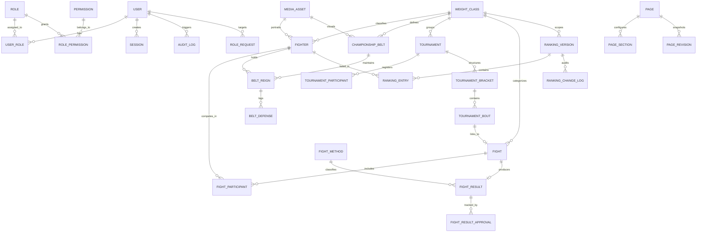

# Database Design & Relational Documentation (MySQL 8 + Prisma)

> **Status:** v1.0 — Implemented in `prisma/schema.prisma`  
> **Source of Truth:** [prd.md](../prd.md)  
> **Provider:** MySQL 8.4 via `@prisma/adapter-mariadb`  

---

## 1. Entity-Relationship Overview



---

## 2. Table Specifications & Cardinality

### A. Authentication & Access Control
- `User`: Primary account record with Argon2id password hash, failed login counter, lockout timestamp, and encrypted TOTP secret (`mfaSecretEnc`).
- `Role`: System roles (`super_admin`, `administrator`, `ranking_manager`, `tournament_manager`, `editor`, `fight_data_manager`, `reviewer`, `viewer`). Includes flags for `requiresMfa` and `isSensitive`.
- `Permission`: Granular capabilities (`fighters.create`, `rankings.publish`, `fights.approve`, etc.).
- `UserRole` & `RolePermission`: Many-to-many join tables with audit metadata (`assignedById`, `createdAt`).
- `RoleRequest`: Four-eyes request/approval workflow for privilege escalation.
- `Session`: Token hash (`tokenHash` SHA-256), `mfaVerified` flag, `lastSeenAt`, `expiresAt`, `revokedAt`.

### B. Fighters & Weight Classes
- `WeightClass`: Divisional limits in both LBS and KG, unique gender + name constraints, sort ordering for navigation.
- `Fighter`: Personal profile, physical metrics (height/reach in cm, stance), and baseline pre-platform record.
  - **Record Normalization:** `wins`, `losses`, `draws`, `noContests`, and `koWins` are recalculated within atomic transactions when official fight results are verified and approved.
  - **Privacy:** `contactEmail`, `contactPhone`, and `privateNotes` are strictly excluded from public DTOs. `dateOfBirth` is shielded behind `showDateOfBirth`.

### C. Rankings (Versioned Official Governance)
- `RankingVersion`: Scoped by division (`DIV:<weightClassId>`) or pound-for-pound (`P4P:MALE` / `P4P:FEMALE`).
  - Version numbers increment per scope.
  - Status transitions: `DRAFT` → `PENDING_APPROVAL` → `PUBLISHED` (superseding previous active version) or `REJECTED`.
- `RankingEntry`: Snapshot of fighter position, rank movement relative to the prior published version, points, and championship flag.
- `FighterRanking`: Denormalized lookup table for instant sub-millisecond public rank queries.
- `RankingChangeLog`: Fine-grained operational audit log of every movement, draft modification, and approval reason.

### D. Championship Belts & Reign Lineage
- `ChampionshipBelt`: Divisional belts with optional 3D asset link (`modelId`) and fallback image (`imageId`).
- `BeltReign`: Chronological lineage of holders.
  - `activeKey`: Unique constraint ensuring only **one active champion** exists per belt at any given time.
  - Holder transitions require official fight result certification and approver sign-off.
- `BeltDefense`: Historical log of each title defense match against named contenders.

### E. Events, Fights & Governance Approvals
- `Event`: Fight night schedules with UTC timestamps, venue, local timezone, and publication state.
- `Fight`: Match card entries with round specifications, title fight indicators, and corner assignments.
- `FightParticipant`: Links fighters to either `RED` or `BLUE` corner, plus official weigh-in data.
- `FightResult`: Outcome (`WIN`, `DRAW`, `NO_CONTEST`), method (`KO`, `TKO`, `UD`, `SD`, etc.), round, time, and scorecards.
  - Status pipeline: `DRAFT` → `PENDING_VERIFICATION` → `VERIFIED` → `OFFICIAL`.
- `FightResultApproval`: Multi-step sign-off ledger enforcing separation of duties.

### F. Grand Prix Tournament Brackets
- `Tournament`: Single/Double elimination formats with power-of-two participant brackets (4, 8, 16, 32).
- `TournamentParticipant`: Seeded fighter entry with active, eliminated, or winner status.
- `TournamentBracket`: Winner or Loser bracket tree.
- `TournamentBout`: Individual bracket node with feeder relationships (`nextBoutId`, `nextSlot`), connected directly to an official `Fight` record.

### G. CMS Page Builder & Media
- `Page` & `PageSection`: Draft configurations for landing page components with JSON schema validation.
- `PageRevision`: Immutable published snapshots enabling single-click rollback.
- `MediaAsset`: Verified file uploads with random storage keys, SHA-256 checksums, and MIME enforcement.
- `HeroSlide`: Dynamic fight night carousel slides with scheduling windows (`publishAt`, `unpublishAt`).


---

## Ticketing Tables (guest order → manual admin verification)

Four tables back the ticketing flow. `TicketType.sold` is the **reserved-capacity counter** — it
counts pending holds *and* confirmed orders, which is what makes the atomic oversell guard possible.

### `TicketType` — sellable category per event

| Column | Type | Notes |
|---|---|---|
| `id` | `String` (cuid) | PK |
| `eventId` | `String` | FK → `Event`, `onDelete: Cascade` |
| `name` | `VarChar(100)` | e.g. `VIP Ringside` |
| `code` | `VarChar(40)` | stable slug, unique per event |
| `description` | `VarChar(500)` nullable | shown on the public category card |
| `price` | `Decimal(12,2)` | IDR |
| `quota` | `Int` | total seats |
| `sold` | `Int` default 0 | **pending holds + confirmed**, mutated only by the guarded `updateMany` |
| `isActive` | `Boolean` default true | inactive categories disappear from `/tickets` |

Indexes: `UNIQUE(eventId, code)`, `INDEX(eventId, isActive)`.

### `TicketOrder` — one guest purchase

| Column | Type | Notes |
|---|---|---|
| `orderNumber` | `VarChar(32)` unique | buyer-facing credential, e.g. `TFN-MWEBJJSG-_I9LEO8` |
| `customerName` / `customerEmail` / `customerPhone` | `VarChar(120/191/40)` | contact + support lookup |
| `totalAmount` | `Decimal(12,2)` | snapshot of price*qty at purchase time |
| `status` | enum `TicketOrderStatus` | `PENDING_CONFIRMATION` → `CONFIRMED` → `USED` \| `REJECTED` \| `CANCELLED` |
| `paymentMethod` / `paymentStatus` | enums | denormalized mirror of `TicketPayment` for list views |
| `guestTokenHash` | `Char(64)` unique nullable | **sha256 of the capability token**; plaintext never stored |
| `confirmedById` / `confirmedAt` / `rejectedAt` | | admin attribution (FK → `User`, `SetNull`) |
| `checkedInAt` / `checkedInById` | `DateTime?` / `VarChar(30)?` | gate admission stamp + usher (FK `TicketOrderScanner`, `SetNull`); both stay `NULL` until the QR is scanned |
| `rejectionReason` / `adminNote` / `customerNote` | `VarChar(500)` | audit context |

Indexes: `INDEX(eventId, status, createdAt)`, `INDEX(customerEmail)`.
`eventId` uses `onDelete: Restrict` — an event with orders cannot be deleted.

### `TicketOrderItem` — line items

`orderId` (Cascade), `ticketTypeId` (Restrict), `quantity`, `unitPrice`, `subtotal`.
`UNIQUE(orderId, ticketTypeId)` prevents duplicate lines for the same category.

### `TicketPayment` — payment evidence and review state

`orderId` (unique, Cascade), `amount`, `method`, `status` enum `TicketPaymentStatus`
(`UNPAID` → `PROOF_SUBMITTED` → `VERIFIED` \| `REJECTED`), `proofUrl`, `reference`, `reviewedById`,
`reviewedAt`. Index `(status, createdAt)`.

### Invariant to protect

```sql
-- must hold at all times for every category
SELECT sold <= quota FROM TicketType;
```

`sold` changes only through (a) the guarded reservation on order creation, (b) the decrement inside
`rejectOrder`. Any other writer (manual SQL, a future cron, a bulk import) must reproduce those
semantics or capacity accounting drifts.
