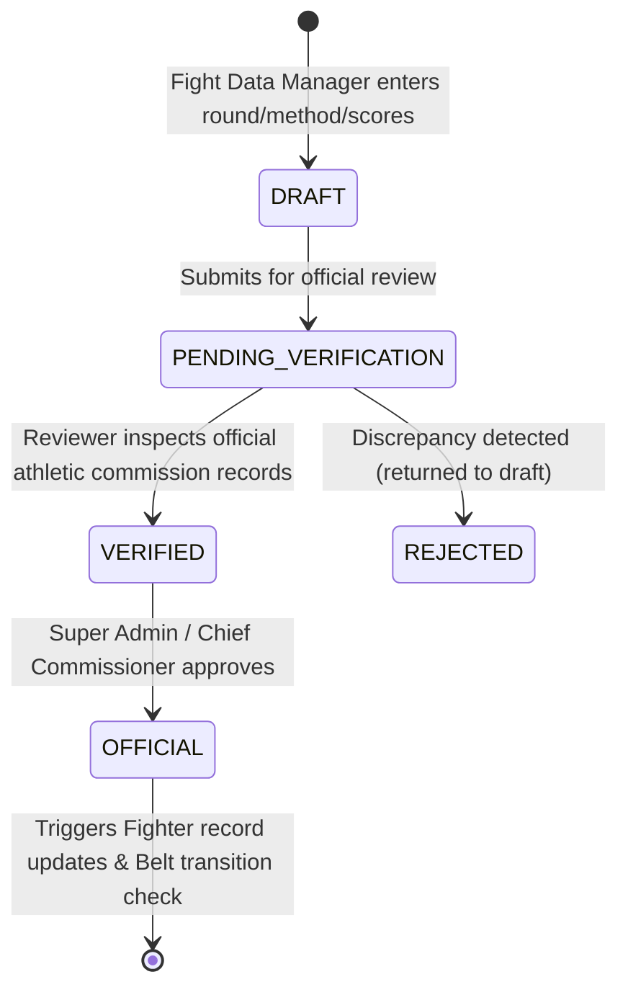
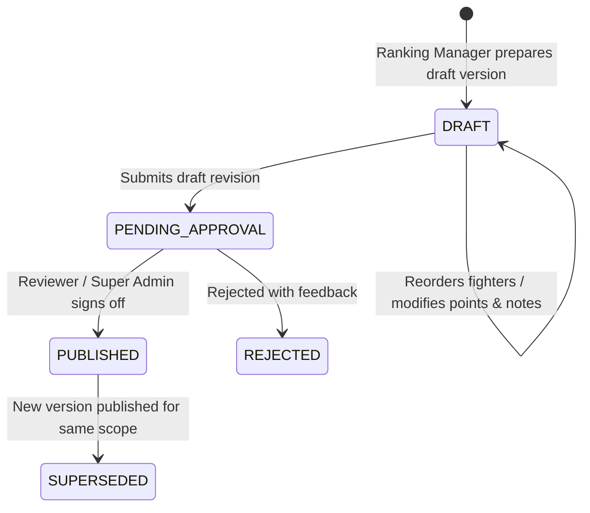
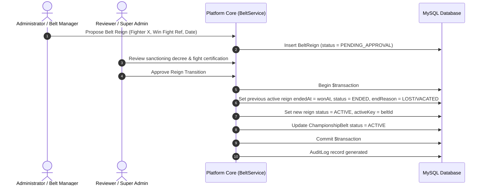

# Official Data Governance & Approval Workflows

> **Status:** v1.0 — Architecture standard  
> **Source of Truth:** [prd.md](../prd.md)  

---

## 1. Overview

In professional sports governance, rankings, fight records, championship lineage, and public announcements cannot be modified unilaterally without formal accountability. This platform enforces **Four-Eyes Verification** and immutable historical logging for:
1. **Fight Result Certification**
2. **Official Ranking Publication**
3. **Championship Belt Holder Transitions**
4. **Landing Page CMS Versioning**

---

## 2. Fight Result Certification Workflow

### Business Rules:
1. **Separation of Roles:** The user who created the draft fight result **CANNOT** act as the verifier or approver.
2. **Atomic Record Normalization:** When a result transitions to `OFFICIAL`:
   - An ACID transaction updates both fighters' `wins`, `losses`, `draws`, `noContests`, and `koWins` by querying official fights.
   - If the bout was designated a title fight (`isTitleFight = true`), a proposed belt reign is queued or resolved.
   - If the bout was a tournament bout (`tournamentBout`), the winner advances automatically to `nextBoutId`.

---

## 3. Official Ranking Publication Workflow

### Business Rules:
1. **Immutable Historical Versions:** Once a version is `PUBLISHED`, its `RankingEntry` rows are locked and become read-only.
2. **Movement Calculation:** When moving from `PENDING_APPROVAL` to `PUBLISHED`, the system automatically computes `previousRank` and `movement` (e.g. `+2`, `-1`, `NEW`) by comparing against the last active version for the same `scopeKey`.
3. **Public Exposure:** Public users query the denormalized `FighterRanking` table or the latest `PUBLISHED` version. Drafts and pending revisions are strictly invisible to the public.

---

## 4. Championship Belt Holder Transition Workflow

### Business Rules:
- The database enforces `UNIQUE(activeKey)` where `activeKey = beltId` when `status = ACTIVE`, and `null` otherwise. This guarantees that **a belt can never have multiple active champions**, even under concurrent race conditions.
- Vacating a belt sets the active reign to `ENDED (VACATED)` and clears `activeKey`, transitioning belt status to `VACANT`.

